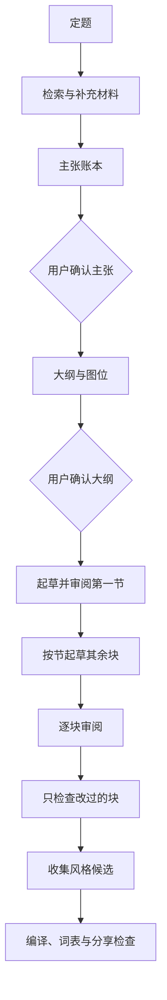
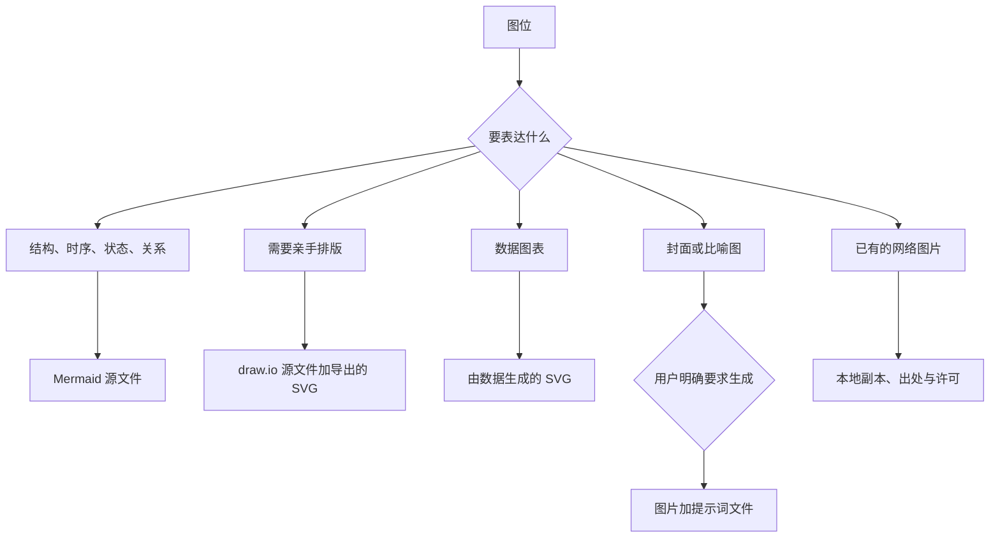

# 架构设计

实现规格。产品形态、使用方式和验收见 [产品规格说明](product-spec.md)。demo 已按本文写到 `skills/chat-to-article/`。用户声音目录和真实文章目录仍不放进 skill 仓库。

## 已定决策

| 事项 | 决定 |
| --- | --- |
| skill id | `chat-to-article` |
| 显示名 | 聊出文章来 |
| 何时加载 | 实现时描述里写明触发语：整理成文章、从聊天写文章、按段改文章。允许按描述自动加载，因为用户往往不会先说 skill 名字 |
| 正文的权威数据 | 块文件。`article.md` 是编译视图 |
| 风格存放 | `~/.chat-to-article/`，可用环境变量 `CHAT_TO_ARTICLE_HOME` 改位置 |
| 文章存放 | 用户指定；未指定时用当前工作区的 `articles/<slug>/` |
| 风格生效方式 | 文章创建时钉住 `styleRevision`；档案更新只影响之后的新文章 |
| 风格规则升级 | 一篇结束时批量确认；自动升级需要来自两篇不同文章的证据，或用户手动提升 |
| 默认写作节奏 | 先起草并审完第一节，再写其余节。用户可以明确要求一次写完 |
| 默认修订范围 | 一个块。整篇重写必须单独确认 |
| 过期传播 | 只有被引用主张发生变化，或该块被大纲删除，才改变块状态。邻居的措辞修改不传播 |
| 默认图格式 | Mermaid。draw.io 需用户导出回 `figures/`。生图每次单独确认 |
| 默认分享 | 不含会话出处，不含风格档案和私有词表 |

## 三处存放

```text
skill 仓库（可共享）
  指令、共享词表、参考说明

~/.chat-to-article/（只属于这个人）
  风格档案、历史版本、私有词表、范文、候选规则

articles/<slug>/（一篇文章，可单独共享）
  主张、大纲、块、图、修订记录、编译稿
```

风格不进文章目录，是为了把文章仓库交给别人时不附带个人词表。文章不进 skill 仓库，是为了 skill 本身保持可安装、可更新。

## 三层文稿



1. **主张账本**记录可以写进文章的事实和判断，每条带来源。这里没有修辞。
2. **大纲**排定章节顺序，每节引用主张 id，并声明图位。大纲确认之后，措辞修订不能偷偷改结构。
3. **块**是正文。一块只允许使用它列出的主张。修订时如果要加新事实，先新增主张并得到确认，再改这块的正文。

四道门：主张、大纲、逐块接受、导出。门的作用是把返工限制在还没写长的那一层。

## 模块

实现阶段这些模块是 skill 参考文档里的步骤，加上少量脚本。脚本只做确定性的事：切分记录、编译、词表扫描、锚点同步。判断、起草、改写仍由 agent 完成。

| 模块 | 职责 |
| --- | --- |
| 材料入口 | 多次短查询找会话，用户勾选后读 JSONL；同时接受粘贴和文件。丢掉 `tool_use`。报告“有全文 / 只有摘要” |
| 主张账本 | 写成候选主张，用户标记接受、拒绝或有争议。标记疑似密钥 |
| 大纲 | 生成章节与图位，等待确认 |
| 图规划 | 按路由表决定格式，建立图记录。不把未导出的 draw.io 会话当成已有图 |
| 块起草 | 输入：钉住的风格版本、词表、本节主张、前后块只读文本。输出：一个块文件 |
| 块审阅 | 一次呈现一块，按指令改这一块，写修订记录，展示这一块的差异 |
| 检查器 | 对脏块做短语和句式扫描，返回块 id 和命中位置。检查器自己不改写 |
| 声音库 | 读写档案版本、范文、候选规则 |
| 编译器 | 按大纲顺序拼 `article.md`，插入块锚点；另出干净导出 |
| 分享守卫 | 禁用词未清零则拒绝导出；列出密钥和出处开关 |

## 文章目录

```text
articles/<slug>/
  meta.json
  claims.jsonl
  outline.json
  blocks/
    b001.md
  figures/
    fig-pipeline.mmd
    manifest.json
  revisions.jsonl
  article.md
  export/
    article.md
    figures/
```

`meta.json`：

```json
{
  "title": "",
  "slug": "",
  "topic": "",
  "styleRevision": 1,
  "locale": "zh-CN",
  "phase": "intake"
}
```

`phase` 取 `intake`、`claims`、`outline`、`drafting`、`review`、`export` 之一。

主张一行一条：

```json
{
  "id": "c1",
  "text": "块修订默认不携带整篇文章。",
  "status": "accepted",
  "sources": [{"kind": "conversation", "id": "<会话 id>", "note": "用户原话要点"}]
}
```

`status` 取 `candidate`、`accepted`、`rejected`、`disputed`。来源 `kind` 还可以是 `file` 或 `paste`。

大纲：

```json
{
  "sections": [
    {
      "id": "s1",
      "title": "修订为什么按块",
      "claimIds": ["c1"],
      "figureIds": ["fig-pipeline"],
      "blockIds": ["b001", "b002"]
    }
  ]
}
```

块文件：

```markdown
---
id: b001
status: draft
claimIds: [c1]
figureIds: []
---

正文只断言 claimIds 里的主张。
```

`status` 取 `draft`、`accepted`、`stale`。

编译进 `article.md` 时，每块前写一行 `<!-- block:b001 -->`。干净导出不写这行。

图记录：

```json
{
  "id": "fig-pipeline",
  "kind": "mermaid",
  "status": "planned",
  "caption": "",
  "alt": "",
  "source": "figures/fig-pipeline.mmd",
  "prompt": "",
  "license": "",
  "blockIds": ["b002"]
}
```

`kind` 取 `mermaid`、`drawio`、`svg-chart`、`raster`、`remote`。`status` 取 `planned`、`drafted`、`accepted`。`raster` 必须有 `prompt`。`remote` 和下载的网络图必须有 `license` 或出处说明。

修订记录一行一条：`blockId`、用户指令、改前摘要、改后状态。风格候选从这里的措辞差异来，不从主张文本的变化来。

## 修订协议

| 用户意图 | 可以写 | 不能写 |
| --- | --- | --- |
| 接受这块 | 该块状态；风格候选 | 其他块、主张、大纲 |
| 改写这块 / 改这句话 | 该块正文 | 其他块；该块未列出的主张 |
| 重画这张图 | 该图源文件和提示词；引用它的说明如果过时则只改那些块 | 与图无关的块 |
| 调整大纲 | 大纲顺序、增删节 | 已接受块的正文。新节才生成新块 |
| 这条主张不对 | 主张状态或文本；引用它的块改为 `stale` | 未引用它的块 |
| 整篇重写 | 全部块，且需再次确认 | 在用户只说“改改”时不得进入此行 |

审阅时的上下文只有：风格档案里的强制规则和范文、私有与共享词表、该块主张、该块当前正文、前一块和后一块的只读正文。没有整篇正文。

`stale` 的块在用户再接受之前不能进入干净导出。

用户直接改了 `article.md`：

- 锚点都在：按锚点把文本收回到块，该块进入审阅，不自动接受。
- 缺锚点：停止同步，列出块 id 和原文，请用户指定改的是哪一块。

## 风格档案

```text
~/.chat-to-article/
  profile.json
  history/r1.json
  lexicon/private.json
  exemplars/
  candidates.jsonl
```

`profile.json` 的形状：

```json
{
  "revision": 1,
  "locale": "zh-CN",
  "audience": "",
  "person": "第一人称",
  "paragraph": {"minChars": 80, "maxChars": 280},
  "structure": {"headingDepth": 2, "listPolicy": "能写成句子就写成句子"},
  "terms": [{"prefer": "聊天记录", "avoid": "对话语料"}],
  "exemplarRefs": ["exemplars/e1.md"],
  "rules": [
    {
      "id": "r1",
      "text": "段首先写具体问题，不写总括句",
      "strength": "enforce",
      "evidenceArticles": 2,
      "status": "active"
    }
  ]
}
```

规则 `status` 为 `candidate` 或 `active`。`strength` 为 `enforce` 或 `prefer`。起草只注入 `active` 规则和范文。候选规则不注入，以免档案在证据不足时把文章越改越空。

从旧文章学习的步骤：读入用户指定的文件，给出可观察统计和建议范文，展示相对当前 `revision` 的差异，用户接受后写入 `history/rN.json` 并把 `revision` 加一。

一篇文章结束时，候选规则逐条询问是否写入。写入后同样增加 `revision`，已钉住旧版本的文章不跟着变。

## 词表

共享词表将来放在 `skills/chat-to-article/lexicon/`。私有词表放在声音目录。条目：

```json
{
  "id": "shared-zh",
  "scope": "shared",
  "phrases": [
    {"id": "p1", "phrase": "值得注意的是", "severity": "ban"}
  ],
  "patterns": [
    {"id": "pat1", "name": "不是A而是B", "severity": "watch"}
  ]
}
```

私有条目多一个 `action`：`ban`、`prefer`（附 `replacement`）、`allow`（附被放行的共享条目 id）。

匹配时先应用 `allow`，再扫 `ban` 和 `watch`。检查结果是 `{blockId, start, end, entryId, severity}`。`ban` 未处理则分享守卫拒绝导出。一次只重写含有命中的句子，块内其余句子保持原样。

研究文档里的起点词表已写入 `skills/chat-to-article/lexicon/`。

## 图表路由



没有用户的明确要求时，不调用生图。数据图不调用生图。draw.io 打开之后，图记录保持 `planned`，直到 `figures/` 里出现源文件和 SVG，再改为 `drafted`。

## 材料入口

1. 把主题拆成多次一到两个关键词的检索。
2. 列出命中的会话标题和摘要，由用户勾选。
3. 对勾选的 id 查找 JSONL。读到全文的，只用 `role` 为 `user` 或 `assistant` 且 `type` 为 `text` 的内容。
4. 只有摘要的会话单独列出，不拿摘要直接写主张。
5. 用户补充的文件和粘贴，用来源 `kind` 区分。
6. 生成候选主张。疑似密钥的片段标出，不写进可分享正文。

子代理记录默认不读。用户点名某次深入调查时再纳入对应 `subagents/` 文件。

## 分享守卫

干净导出包含编译后的 Markdown 和 `figures/` 里被大纲引用且状态为 `accepted` 的文件。不包含 `claims.jsonl`、修订记录、块锚点和声音目录。

导出前：

- 所有块为 `accepted`
- 引用的图为 `accepted`
- 无未处理的 `ban`
- 密钥标记已由用户处理
- 用户确认是否附带主张出处；默认不附带

## 实现阶段的 skill 目录

demo 已创建这个目录。主文件保持短，细节放在并列的参考文件里，从 `SKILL.md` 单层链接出去。

```text
skills/chat-to-article/
  SKILL.md
  references/
    sources.md
    revision.md
    style.md
    figures.md
    lexicon.md
  lexicon/
    shared-zh.json
    shared-en.json
    patterns.json
```

`SKILL.md` 的 frontmatter：

```yaml
name: chat-to-article
description: >-
  把某个主题下的过往聊天整理成可回顾、可共享的文章，并按块修订。
  维护版本化的个人写作风格、共享与私有词表，以及 Mermaid、draw.io 和经确认的插图。
  在用户要把聊天整理成文章、回顾一个主题的对话，或修改文章中的某一段、某一张图时使用。
```

`SKILL.md` 只保留工作流、门禁和“默认只改当前块”。检索细节、词表格式、图路由、档案格式放进 `references/`。主文件控制在 500 行以内。

确定性脚本在 `skills/chat-to-article/scripts/cta.py`，使用 Python 3 标准库。已覆盖：JSONL 抽出文本、按锚点同步、词表扫描、按大纲编译。起草逻辑不在脚本里。

## 失败时的行为

| 情况 | 行为 |
| --- | --- |
| 检索没有命中 | 请用户给会话标题、文件或粘贴，不空写一篇 |
| 只有摘要 | 摘要只用于请用户回忆，不生成主张 |
| draw.io 已打开但目录里没有文件 | 图保持 `planned`，文章里留图位，不插入断裂图片 |
| 用户没要求生图 | 跳过 `raster`，改用 Mermaid 或文字 |
| 风格档案不存在 | 用空档案起草第一节，审完后把用户的修改写成第一批候选 |
| 块修订指令含糊到像在改结构 | 先问是改这一块、改大纲，还是改主张，不默认整篇重写 |
